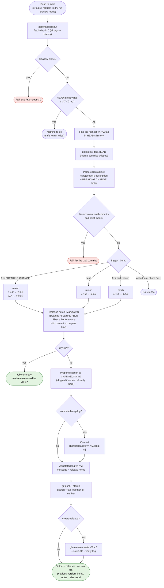

# Problem #7

**Develop a reusable Jenkins shared library (Groovy) or GitHub Actions composite action that performs
semantic versioning, changelog generation, and automated Git tagging based on conventional commits.**

This is a **GitHub Actions composite action**. The work is done by one small Python script
(`src/semver_release.py`, standard library only), so the same logic also runs on a laptop or in any
other CI tool, Jenkins included.

## What it does

On every push to `main`:

1. Finds the last release tag (`v1.4.2`) in the branch's history.
2. Reads the commits since then and works out the bump from Conventional Commits:

   | Commit | Bump | Example |
   |---|---|---|
   | `feat!: ...`, `fix(api)!: ...` or a `BREAKING CHANGE:` footer | **major** | 1.4.2 → 2.0.0 |
   | `feat: ...` | **minor** | 1.4.2 → 1.5.0 |
   | `fix: ...`, `perf: ...`, `revert: ...` | **patch** | 1.4.2 → 1.4.3 |
   | `docs:`, `chore:`, `ci:`, `test:`, `style:`, `refactor:`, `build:` only | none | no release |

3. Writes the release notes and puts them at the top of `CHANGELOG.md`.
4. Creates an **annotated** tag `v1.5.0` (its message is the release notes) and pushes it.
5. Optionally creates a **GitHub Release** and commits `CHANGELOG.md` back to the branch.

## Architecture



The diagram was made with Mermaid. Its source is in `docs/release-flow.mmd`, and GitHub also draws it
from the block below. [Open it in the Mermaid editor](https://mermaid.ai/app/plugin/save?state=pako%3AeNptVs1y3DYMfhVEPnQ9WcnrtTudatp07Dh20h_Hk_bQNpsDV4IkZiVRJimvdzy59gH6iH2SAiS1ku34QgokPgAfPmL9EGUqxyiNilpts0poC39crFqgv6431ezjKrqhFayCRsj2h7U-ejVTGgQd1zVovO3RWJAt5HoX676FTuOdxC00hHu4ij4dQhy_gqzCbKN6S3gis1K15mgwOcwCbVbFOXa2SmEBM0HgVpQGXkIljVV6x1g-scHRAZuKrqrtwyr63e8gq1WLP62iL_52uECXYYfG-aDWx1zZpZB1Cr1BeByes37m3CrnW6HIKdjbN2cXIGpNXzuohHFFCLj7M_kr-ZszHxNgj2n0VqnOhb9WtpJtydzmyjNrRIH8zUTarcw8g49xQiK1MMzmpWxzsBUSTWXFrRhTcJDUGc71GzPwuKeRATySKgmolJZ3zhyTd5Kwn0-rQV0iZKpppDVgNrLrMB8bwm4M1AltkBXDK6DIKjD9-jNmNnU4dtfhzGSqw8MXKeRoMi07FoM7fQnnH96c_fLu-gpevz27vnqTQqGURb2P4_B9162WmX1gDts4U-0dtowj6iFJ3w-ixt90apxowhsfS2I5SqImqhypa6I8IE5EsfcOrVj3TUe5nMuy5A7w5z4Uf_DVVfQC6N08KXEVOYBGfFaaorvVpX6cnCZL-O-ff2GZLJKFb8MiuXemRrZKj_QPIQoUvqHunOF4fQJ3nHybLJ65rqJC3sMRdKgLWugJo7YhuU7Q2yA0tz5DO01OvoKm2npHos4MgWWV0sirTJIkYPIbWPo3QMFqFAZHfh0L4ZpFE4xcy1OjS-mp0W0J-oPH9d8w-03oTa627aEr4Zxe7oYf3xFcEm29Rk71vC_hUt67_Q1RoXQj2gydx1baKmiBhhJtSI1ISmk3LA2XBI1AkkEYhKPayDCVWhiQXP3Pak0vpGmE3vkX0uK9HQiBrerrHNYYnvRIUAAM6qOp3ZboH_GNxg5Z9eiGLI8SL7Rf318lTR6GjH-_IAugNhu-N0wy0rzG6aQN0D6QK_6WSvS7eH881hruTOv1Jkrutdu4HJwmZqHQw3QYWh85NRLKpzGDES-US6NpejTYCP-spVYLS5XRd4B00Ro0RtAA-3FPrZfLEISvu87QL91tGIW8J6OwqpGZQ1lr0kJFvefrVpXIZM35UbcoeT_OKcZxiBSP6SJyLcYh-EgWGaZElRUZOHy1z9N7TmuJY5d7XMiaRyE1UBY7ntf76AE10EW_k97s0AcTi-99b7vemnQIls8HOcy5xLkL58SqehPvj_iRzz2B88E17nXt5RlaQz8i5gILNz8p0zo9KHJc4vGcZqfaYHqQLU6-X67nmaqVTg8Wi8UTx1KpwRNPitOJ5xK_y0-WX_d0v-xznuUceXpANc-H_0wYO_ryP0Vq5gE&utm_source=mermaid_app_widget&utm_medium=claude-app-v1).



## Repository layout

```
Problem #7/
├── action.yml                    the composite action (inputs, outputs, 3 steps)
├── src/semver_release.py         the engine: parse, bump, changelog, tag, push
├── examples/
│   ├── release.yml               workflow: release on every push to main, then build the tag
│   ├── preview.yml               workflow: on pull requests, show the next version (dry run, strict)
│   ├── sample-run.log            real output of four runs on a demo repository
│   └── sample-CHANGELOG.md       the changelog those runs produced
├── tests/
│   ├── test_unit.py              parsing, bump rules, changelog text (41 tests)
│   ├── test_git.py               the script against REAL git repos with a local remote (26 tests)
│   └── test_action.py            action.yml and the script agree (5 tests)
├── docs/release-flow.svg / .mmd  the diagram
└── .github/workflows/ci.yml      lint + tests on Python 3.10/3.12/3.14 + runs the action on itself
```

## Quick start

1. Put this action in its own repository (for example `yefterpatino/problem-7`) and tag it `v1.0.0`.
2. In the repository you want to release, add `.github/workflows/release.yml` (from
   `examples/release.yml`):

```yaml
permissions: {}
concurrency: { group: release, cancel-in-progress: false }

jobs:
  release:
    runs-on: ubuntu-latest
    permissions:
      contents: write            # push the tag, create the release
    steps:
      - uses: actions/checkout@3d3c42e5aac5ba805825da76410c181273ba90b1 # v7.0.1
        with:
          fetch-depth: 0             # REQUIRED: all tags and commits
          persist-credentials: false
      - id: semver
        uses: yefterpatino/problem-7@<commit-sha> # v1.0.0
        with:
          create-release: "true"
```

3. Write commit messages (or squash-merge pull request titles) as Conventional Commits:
   `feat(api): add search`, `fix: handle empty body`, `feat!: drop Python 3.9`.

Optional: add `examples/preview.yml` so every pull request shows which version it would release, and
fails if a commit message is not a Conventional Commit.

## Inputs

| Input | Default | Meaning |
|---|---|---|
| `tag-prefix` | `v` | `v` gives `v1.2.3`; `""` gives `1.2.3`; `api-v` gives `api-v1.2.3` (monorepos) |
| `initial-version` | `0.1.0` | Version of the first release |
| `minor-types` | `feat` | Types that bump the minor version |
| `patch-types` | `fix,perf,revert` | Types that bump the patch version |
| `major-on-zero` | `false` | In 0.x, a breaking change only bumps the minor (SemVer: 0.x is unstable). Set `true` to go to 1.0.0 |
| `changelog-file` | `CHANGELOG.md` | File to update |
| `commit-changelog` | `false` | Commit the changelog to the branch and push it with the tag (see below) |
| `branch` | the current branch | Branch for the changelog commit |
| `push` | `true` | Push the tag |
| `dry-run` | `false` | Calculate and report only |
| `strict` | `false` | Fail on commits that are not Conventional Commits |
| `create-release` | `false` | Create a GitHub Release with the notes |
| `github-token` | `github.token` | Token for pushing and for the release (`contents: write`) |
| `git-user-name` / `git-user-email` | github-actions[bot] | Who the tag is recorded as |

## Outputs

| Output | Example |
|---|---|
| `released` | `true` |
| `version` | `1.5.0` |
| `tag` | `v1.5.0` |
| `previous-version` | `1.4.2` |
| `bump` | `minor` (or `major`, `patch`, `initial`, `none`) |
| `notes` | the Markdown release notes |
| `release-url` | link to the GitHub Release |

## Example output

From `examples/sample-CHANGELOG.md`, produced by the real script on a demo repository:

```markdown
## [0.3.0](https://github.com/yefterpatino/problem-7-demo/compare/v0.2.0...v0.3.0) (2026-10-23)

### ⚠ BREAKING CHANGES

* **api:** clients must call /v2/... instead of /v1/... ([97ad0b9](...))

### Features

* **api:** remove the v1 routes ([97ad0b9](...))

### Bug Fixes

* correct the timeout default ([3225448](...))
```

## The changelog file and protected branches

By default the action **does not push a commit to `main`**. It only pushes the tag, which puts the
changelog in the tag message and in the GitHub Release. This is on purpose: a protected `main` (like in
Problem #6) refuses pushes from `GITHUB_TOKEN`.

If you want `CHANGELOG.md` committed to the branch, set `commit-changelog: "true"` and give the action a
token that is allowed to push to `main`: a GitHub App token added to the branch ruleset's bypass list.
The commit message is `chore(release): v1.5.0 [skip ci]`, so it does not start the pipeline again. The
branch and the tag are pushed with `git push --atomic`: if the branch push is refused, the tag is not
published either.

## Security considerations

- **Least privilege.** The release job needs only `contents: write`. The preview job needs only
  `contents: read`.
- **The token is never on a command line.** The script passes it to that one `git push` through
  `GIT_CONFIG_*` environment variables. If `actions/checkout` already stored credentials, it uses those
  instead, which avoids a duplicate-header error.
- **No script injection.** Inputs reach the script only through `env:`, never pasted into a `run:`
  block. A test enforces this.
- **Release tags are never moved.** If the computed tag already exists anywhere (another branch, the
  remote), the run fails instead of moving it.
- **Pin this action by commit SHA** in your workflows, as with every third-party action.
- **Tags pushed with `GITHUB_TOKEN` do not trigger other workflows.** GitHub does this to prevent
  loops. That is why `examples/release.yml` builds the release in a `build` job of the same workflow.
  Use a GitHub App token if you need the tag to start a separate workflow.

## Idempotency

- If the current commit already has a release tag, the action does nothing (`released=false`).
- If there are only `docs`/`chore`/`ci` commits, there is no release and no tag.
- A version that is already in `CHANGELOG.md` is never added twice.
- `concurrency: release` in the workflow stops two releases from running at once and picking the same
  version.

## Testing and CI

```bash
pip install pytest pyyaml ruff actionlint-py zizmor
ruff check . && ruff format --check .
python -m pytest                     # 72 tests, about 8 seconds, no network
actionlint .github/workflows/*.yml examples/*.yml
zizmor --offline .github/workflows/ examples/ action.yml
```

- **`test_git.py`** creates real git repositories with a real (local, bare) remote for each test. It
  covers:
  - first release, every bump type, the `BREAKING CHANGE:` footer and the 0.x rule
  - nothing to release, running twice, dry run, strict mode, custom prefixes
  - shallow clones, tags on other branches, merge commits, and a tag that already exists elsewhere
  - a remote that refuses the branch push (like a protected branch), where the tag must not be pushed
    either
- **The tests were checked by breaking the code on purpose** (removing the 0.x rule, the
  "tags in this branch only" filter, merge skipping, idempotency, `--atomic`, the dry-run guard, the
  footer parsing, and the setting that keeps `##` lines in tag messages). Each break made at least one
  test fail.
- **`ci.yml`** runs everything on Python 3.10, 3.12 and 3.14. It also runs the action on its own
  repository in dry-run mode.

## Limitations

- **Not run on GitHub yet.** The script was run against real git repositories here, but the composite
  action wrapper and the `gh release create` step run for the first time in your repository.
- **Pre-releases** (`1.5.0-rc.1`) are not created, and are ignored when looking for the last version.
- **One version per tag prefix.** For a monorepo, run the action once per package with a different
  `tag-prefix`. Note that every commit counts for every package; filtering by path is not built in.
- **Squash merges** make the pull request title the commit message, so check titles with the preview
  workflow. With merge commits, the individual commits are used and the merge commit is skipped.
- **A Jenkins shared library** is not included. The script is CI-neutral: a `vars/semanticRelease.groovy`
  step only needs to run `python3 semver_release.py` with the same `SR_*` variables.

## Troubleshooting

| Message | Cause | Fix |
|---|---|---|
| `this is a shallow clone` | Checkout without full history | `fetch-depth: 0` on `actions/checkout` |
| `Nothing to release` | Only docs/chore/ci commits since the last tag | Expected; or add types to `patch-types` |
| `tag v1.5.0 already exists (but not on HEAD)` | That version was released from another branch | Merge that branch, or delete the stray tag on purpose |
| `protected branch` or `GH006` when pushing | `commit-changelog` with a token that can't push to `main` | Leave `commit-changelog` off, or use a GitHub App token with bypass |
| `Resource not accessible by integration` | Missing `contents: write` | Add it to the job's `permissions` |
| Commits ignored in the log | Not Conventional Commits | Use `type: description`; turn on `strict` to enforce |
